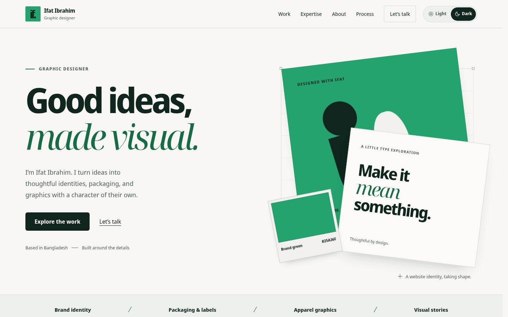
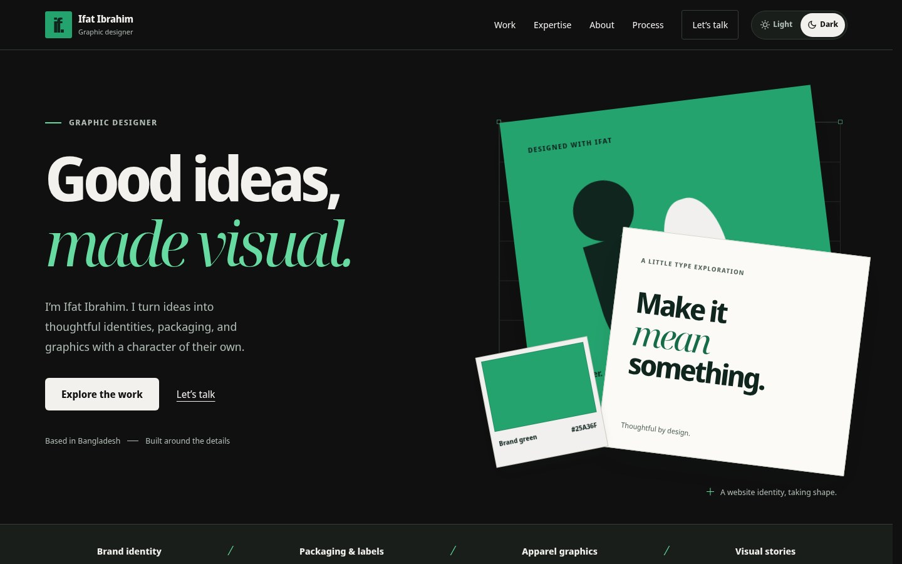
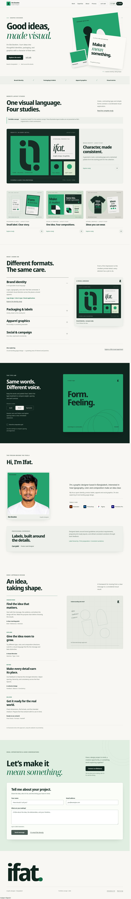
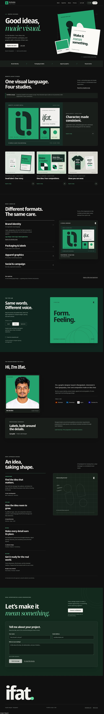
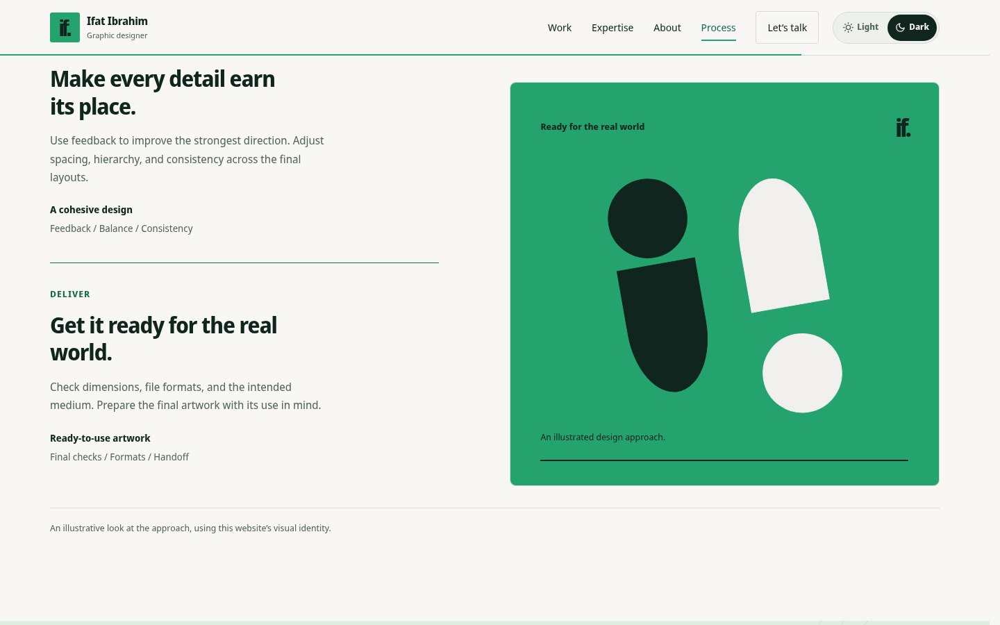
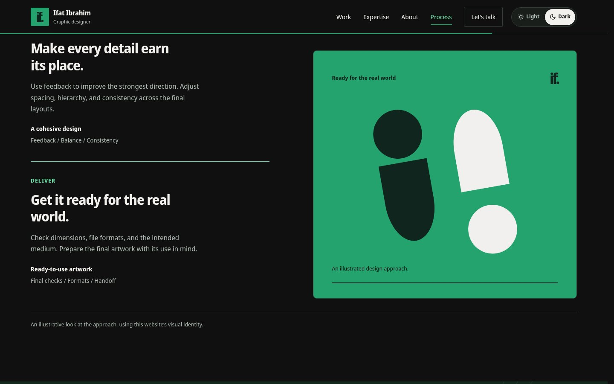
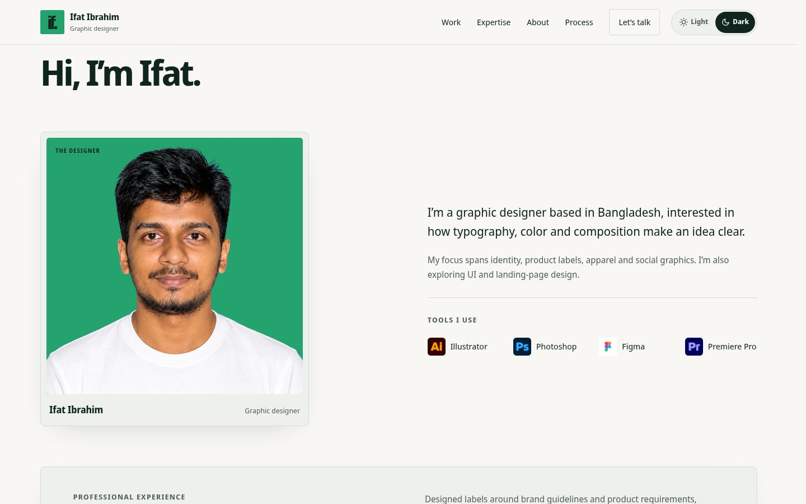
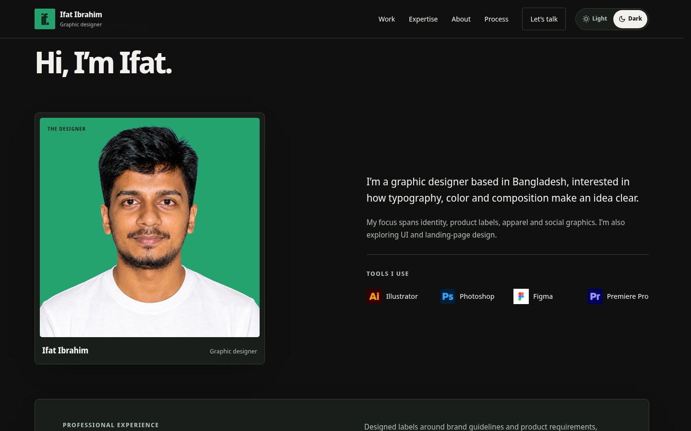

<div align="center">

# Ifat Ibrahim — Graphic Design Portfolio
### *Production-Grade Modern Web Application for an Editorial Graphic Designer*

[](https://nextjs.org/)
[](https://react.dev/)
[](https://www.typescriptlang.org/)
[](https://tailwindcss.com/)
[](https://greensock.com/)
[](https://lenis.darkroom.engineering/)
[](https://vercel.com/)
[](https://nodejs.org/)

<br />

**[Live Production Site ↗](https://ifat-portfolio.vercel.app/)** &nbsp;•&nbsp; **[Designer's Behance ↗](https://www.behance.net/designedwithifat)**

<br />

<p align="center">
  
  
</p>

</div>

---

## Executive Summary

This project is a high-performance, responsive portfolio web application designed and built for **Ifat Ibrahim**, a professional graphic designer based in Bangladesh specializing in brand identity, packaging, labels, and apparel graphics.

As the **Full-Stack Frontend Engineer**, I architected and engineered this project from ground up. Moving far beyond static portfolio sites, I implemented an editorial interactive experience featuring scroll-linked GSAP scenes, kinetic typography, momentum scrolling via Lenis, a custom dual-theme (#101010 dark / editorial paper light) system, and an enterprise-grade secure contact pipeline.

> **Key Result:** 100% responsive, sub-second TTFB, zero hydration layout shift, fully accessible (WCAG AA & reduced-motion), and backed by an automated regression test suite.

---

## Key Features & Architectural Highlights

### 1. Fluid Editorial Aesthetics & Dual Themes
- **Adaptive Dark & Light Modes:** Tailored dark mode anchored on `#101010` onyx black with emerald green accents (`#3dd68c`) and crisp `#f2f0ef` typography, seamlessly toggleable from an accessible segmented pill switch in the header.
- **Zero-Flash Theme Bootstrapping:** Inlined layout script prevents FOUC (Flash of Unstyled Content) and preserves visitor preferences across sessions.
- **Dynamic GSAP Stage Color Adaptation:** ScrollTrigger stages seamlessly crossfade their palette based on the active theme without destroying the active animation state.

### 2. Cinematic Animation & Kinetic Interactions
- **Lenis Inertia Scrolling:** Buttery-smooth wheel physics with exponential ease-out curves (`t => Math.min(1, 1.001 - Math.pow(2, -10 * t))`), isolated from interfering browser native focus jumps.
- **GSAP & ScrollTrigger Scenes:** Multi-step sticky process visual showing the journey from *Understanding the Brief* to *Real-World Delivery*.
- **Motion Micro-Interactions:** Tactile spring-based interactions on buttons, hover cards, dialog backdrops, and navigation controls.
- **Graceful Fallback Runtime:** Automatically shifts to pure CSS native entrance animations if client-side chunk loading is disrupted or JavaScript is disabled.

### 3. Interactive Typography Laboratory ("Type Lab")
- Client-side interactive typography playground allowing clients and recruiters to preview weight, tracking, and serif contrast across different design voices (*Quiet*, *Direct*, *Expressive*) in real-time.
- Interactive composition grid overlay toggled via Framer Motion.

### 4. Enterprise-Grade Serverless Contact Engine
- **Next.js App Router Route Handler (`/api/contact`):** Server-side submission workflow using Nodemailer with TLS security.
- **Zero Client Credential Leakage:** All SMTP authentication parameters are locked in server-only environment variables.
- **Multi-Layer Threat Mitigation:**
  - Automated Honeypot trap rejection.
  - Strict input sanitization with header-injection prevention.
  - In-memory sliding-window IP rate limiter.
  - `Reply-To` preservation with unalterable recipient delivery.
  - Form state preservation on transient delivery errors.

---

## Visual Showcase

<div align="center">

| Light Mode (`#F2F0EF` Paper) | Dark Mode (`#101010` Onyx) |
| :---: | :---: |
|  |  |
|  |  |
|  |  |

</div>

---

## Technology Stack

| Domain | Technology / Library | Purpose & Implementation |
| :--- | :--- | :--- |
| **Core Framework** | **Next.js 16 (App Router)** | Server-side rendering, static generation (SSG), file-system routing |
| **UI Library** | **React 19** | Component-driven declarative UI with modern hooks and transitions |
| **Language** | **TypeScript 5.9** | Strict type safety across content models, APIs, and runtime components |
| **Styling** | **CSS3 + Tailwind CSS v4** | Modular CSS cascades, design token architecture, modern layer management |
| **Orchestration** | **GSAP 3.15 + ScrollTrigger** | Pinning, timeline scrubbing, parallax sheets, and scene transitions |
| **Micro-Motion** | **Motion 14 (Framer)** | Gestures, spring physics, dynamic TypeLab controls, and modal transitions |
| **Smooth Scroll** | **Lenis 1.3** | Inertia smoothing, normalized scroll delta, and programmatic anchor travel |
| **Backend / API** | **Node.js Route Handlers** | Serverless API routes for contact inquiries and security verification |
| **Email Protocol** | **Nodemailer 10** | Authenticated secure SMTP transmission over TLS |
| **Testing** | **Node Test Runner (`node:test`)** | Automated integration tests for rate limits, validation, and security |
| **Deployment** | **Vercel** | Edge-cached production hosting, automated preview CI/CD, SSL termination |

---

## Project Architecture

```plaintext
ifat-portfolio/frontend/
├── public/
│   ├── assets/              # Scalable SVG studies, optimized WebP portraits, tool icons
│   │   ├── fonts/           # Studio Sans & Studio Serif local webfonts
│   │   └── tools/           # Software skill badges (Illustrator, Photoshop, Figma, etc.)
│   └── no-script.css        # Zero-JS accessibility fallback styling
├── src/
│   ├── app/                 # Next.js App Router root layout & routes
│   │   ├── api/contact/     # Secure server-side contact API endpoint
│   │   ├── work/[slug]/     # Dynamic case study route
│   │   ├── layout.tsx       # Root layout with zero-flash theme bootstrap
│   │   └── page.tsx         # Portfolio single-page layout
├── components/          # React presentation & interactive components
│   │   ├── SiteHeader.tsx   # Sticky header with responsive navigation
│   │   ├── ThemeToggle.tsx  # Segmented Light / #101010 Dark pill switch
│   │   ├── TypeLab.tsx      # Interactive kinetic typography laboratory
│   │   ├── WorkGallery.tsx  # Dynamic filterable project showcase
│   │   └── ContactForm.tsx  # Validated inquiry submission form
│   ├── content/             # Structured profile data and case study schemas
│   ├── lib/                 # Backend validators, SMTP intent & animation engines
│   │   ├── runtime/         # Progressive GSAP, Lenis, and Fallback runtimes
│   │   └── mail-intent.mjs  # Production email security rules
│   └── styles/              # Cascade architecture (styles, polish, dark-theme, animations)
├── tests/                   # Automated unit and integration test suite
├── docs/                    # Architectural benchmarks, verification specs, and UI review
├── package.json             # Pinned enterprise dependencies
└── tsconfig.json            # Strict TypeScript compiler options
```

---

## Quality Assurance & Automated Testing Suite

Every deployment must pass strict automated validation checks before build time:

```bash
# Run complete verification suite (Typecheck + Automated Tests + Asset Audit)
npm run check
```

```plaintext
✔ validation accepts a real inquiry and trims surrounding whitespace
✔ validation rejects header injection, invalid addresses, honeypots, and invalid types
✔ mail intent fixes recipient and SMTP sender while preserving visitor reply-to
✔ SMTP configuration uses TLS and never accepts missing credentials
✔ request handler sends one message and confirms only SMTP acceptance
✔ missing credentials return 503 without attempting delivery
✔ cross-site and invalid submissions never reach the mail transport
✔ body limit is enforced even when Content-Length is absent
✔ rate limit denies before SMTP and returns a retry interval
✔ native entrances replay on re-entry and leave content visible after cleanup
✔ reduced-motion retains gentle opacity-only entrances
✔ theme changes retain the motion engine and use color-only transitions
✔ fresh visits default to light with full motion
✔ explicit dark theme survives reload, but legacy motion preferences do not
ℹ tests passed | all test suites green
Verified local asset references and required application files.
```

---

## Getting Started Locally

### Prerequisites
* **Node.js**: `v22.0.0` or higher
* **npm**: `v10.0.0` or higher

### Installation & Launch

1. **Clone the repository:**
   ```bash
   git clone https://github.com/ZxAYED/ifat-portfolio.git
   cd ifat-portfolio
   ```

2. **Install exact dependencies:**
   ```bash
   npm ci
   ```

3. **Configure environment variables (optional for contact form):**
   ```bash
   cp .env.example .env.local
   ```
   *(Configure your Gmail SMTP App Password in `.env.local` to enable live message forwarding)*

4. **Start development server:**
   ```bash
   npm run dev
   ```
   *Visit `http://localhost:3000` to preview.*

5. **Execute production build:**
   ```bash
   npm run build
   npm run start
   ```

---

## Engineering Competencies Demonstrated

This project demonstrates production-level engineering capabilities:
* **Modern React & Next.js mastery**: Proficient with App Router, Server/Client components boundary, serverless Route Handlers, and SEO optimization.
* **Creative Technology & WebGL/Canvas Animation**: Expert-level orchestration of GSAP, ScrollTrigger, Framer Motion, and Lenis for silky-smooth 60fps animations.
* **Security Best Practices**: Solid defensive engineering (CORS validation, payload size limits, rate limiting, SMTP header injection defenses, zero secret exposure).
* **Responsive Architecture & A11y Compliance**: Dedicated support for WCAG guidelines, screen readers, semantic tags, and OS `prefers-reduced-motion` modes.
* **Production Polish**: Pixel-perfect translation of complex designer concepts into maintainable code.

---

## Developer Profile & Contact

Built with precision and passion by **ZxAYED**.

* **GitHub**: [@ZxAYED](https://github.com/ZxAYED)
* **Email**: [zzayediqbalofficial@gmail.com](mailto:zzayediqbalofficial@gmail.com)
* **Portfolio**: [Live Production Site ↗](https://ifat-portfolio.vercel.app/)

---

<div align="center">
  <sub>Designed for <b>Ifat Ibrahim</b> • Engineered with Next.js, TypeScript & GSAP • © 2026</sub>
</div>
